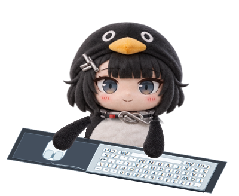
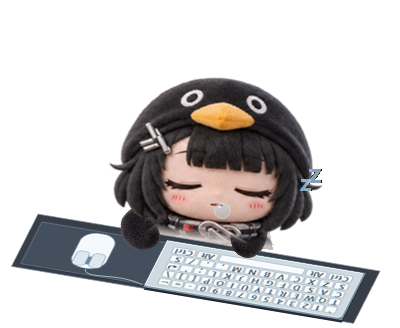

# gugugaga pet

English | [简体中文](README.zh-CN.md)

Meet **guga** — **咕咕嘎嘎** in Chinese — a plush penguin-costume desktop companion for Windows. Type, move your mouse, or take a break: guga keeps you company with little gestures and expressions.



## Features

- **Typing companion:** the keyboard paw moves toward the corresponding key, presses down, and lifts on release. Common letter, number, punctuation, and modifier keys light up on the miniature keyboard.
- **Mouse companion:** the other paw follows the pointer across a small mouse pad. Mouse buttons and scrolling have their own feedback; typing and mouse movement work together.
- **Expressive reactions:** calm, blinking, happy, focused, sleepy, and surprised expressions, with gentle breathing and head movement.
- **A proper little nap:** after 45 seconds without input, guga settles onto relaxed paws, breathes slowly, and occasionally nods and rebounds. New input wakes guga and restores normal interaction.
- **Desktop controls:** drag to move, click to pet, and use the right-click menu for size, opacity, always-on-top, click-through, hiding, and position recovery.
- **English and Chinese:** open Settings and click the visible **中文** or **English** button at the top, or choose **语言 / Language → English / 中文** in the right-click menu. The selected language is remembered on normal exit.



## Run on Windows

Requires **64-bit Windows 10 or 11** with **.NET Framework 4.8**. No Python, Node.js, installer, or administrator privileges are needed.

1. Extract `gugugaga-pet-Windows-x64.zip`.
2. Run `gugugaga pet.exe`.
3. Right-click the pet or its tray icon for controls. A fresh installation starts in Chinese. Open **设置与使用说明** and click the **English** button at the top; settings, menus, and tray text update immediately.

If the language buttons are missing, close the older pet and launch the EXE from the latest portable package. The version is shown at the top of Settings; this update is **v1.1.0**.

| Action | Result |
| --- | --- |
| Drag the pet | Move the window |
| Click the pet | Pet guga and see a smile |
| Right-click | Open controls and language selection |
| **Let guga nap** | Preview the nap; new input wakes guga |
| Double-click the tray icon | Show and pet guga |
| Run the EXE again | Show the existing pet, disable click-through, and restore its position |

Size ranges from 160 to 440 px; opacity ranges from 35% to 100%. Restore click-through from the tray menu. The tray icon may be inside the hidden-icons area.

## Privacy and settings

The app works offline and makes no network requests. Windows input hooks supply transient key codes, pressed/released states, and pointer coordinates to animate the pet. These are not converted into typed text, logged, or uploaded. Clipboard contents are not read, and input events are always passed on to other applications.

Session counters exist only in memory. Settings are stored in `%LOCALAPPDATA%\PenguinPet\settings.json`; the folder name is retained for compatibility. Saved preferences include size, opacity, position, always-on-top, visual effects, and language. Hidden and click-through states reset on the next launch. The app does not install a background service or enable startup automatically.

Input reactions may be unavailable on the lock screen, the UAC secure desktop, or in protected applications. The model is a layered sprite rig with textured arm deformation, rather than a Live2D model. The miniature keyboard displays a subset of a full physical keyboard.

## Build and test

Close the running pet before rebuilding. In the project directory, run:

```powershell
powershell -NoProfile -ExecutionPolicy Bypass -File .\build.ps1
powershell -NoProfile -ExecutionPolicy Bypass -File .\test.ps1
```

The build uses the Windows .NET Framework C# compiler and embeds both texture atlases in the executable. `PenguinPet.exe` is also generated as a compatibility entry point for older shortcuts.

The self-test checks window visibility, hook registration, key states, expressions, resting and wake transitions, pause, click-through, resizing, hiding, recovery, and both languages. Pose previews are saved in `test-output`. It does not inject input into other apps. To check global interaction manually, type in a text editor, move the pointer, click, and scroll while watching the pet.

## Package

```powershell
powershell -NoProfile -ExecutionPolicy Bypass -File .\package.ps1
```

This produces source and Windows portable archives under `dist`, plus SHA-256 checksums. The source package includes code, required generated assets, asset provenance, both READMEs, build/test/package scripts, and previews. Local settings, reference attachments, test output, and older binaries are excluded.

## Source layout

```text
src/PenguinPet.cs       Window, input state, settings, tray controls
src/DeskScene.cs        Perspective desktop and textured arm rendering
src/CompanionMotion.cs  Expressions, breathing, dozing and wake transitions
src/Ui.cs               English / Chinese interface text
assets/                 Required texture atlases and generation notes
docs/                   Preview images
build.ps1               Compile the executable
test.ps1                Run the self-test
package.ps1             Create source and portable archives
```

## Suggestions and feedback

Ideas and bug reports are welcome. Once this project is on GitHub, open its **Issues** tab and choose **Feature request / 功能建议** or **Bug report / 问题反馈**. Bilingual forms are included in `.github/ISSUE_TEMPLATE` to make feedback easier to collect and review.

For a feature suggestion, describe:

- What you would like to change: gestures, expressions, appearance, interaction, accessibility, or something else.
- When it would help, and what the result should look or feel like.
- Whether it is essential or a nice-to-have; a sketch or reference can help.

For a bug, include the version shown in Settings, your Windows version, the steps to reproduce it, the expected and actual behavior, and an optional screenshot or short recording. Remove private information before sharing screenshots.

Before opening a new issue, check existing reports. Related ideas can be added to an existing discussion. Reports help guide future updates; feature requests are considered according to usefulness, clarity, and implementation effort.

## Credits

Interaction and posture are inspired by [ayangweb/BongoCat](https://github.com/ayangweb/BongoCat). This is an independent Windows implementation; it does not include BongoCat source code or Live2D assets.
