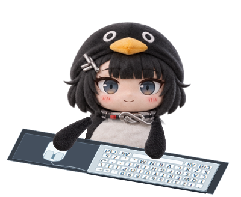
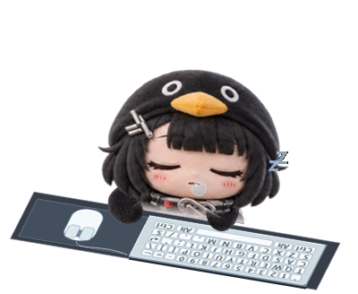

# 咕咕嘎嘎桌宠

[English](README.md) · [下载 Windows 便携版](https://github.com/mioyui20/gugugaga-gugutata-pet/releases/latest/download/gugugaga-pet-Windows-x64.zip)

咕咕嘎嘎（guga）是一只穿着企鹅服的 Windows 桌宠。你敲键盘，它也跟着敲。你移动鼠标，它的小手也会跟着动。你离开一会儿，它就趴在桌上打盹。

## 下载后怎么打开

需要 **64 位 Windows 10 或 11** 和 **.NET Framework 4.8**。解压即可运行，普通用户权限就够用。

1. 下载并解压 `gugugaga-pet-Windows-x64.zip`。
2. 双击 `gugugaga pet.exe`，试试打字或移动鼠标。
3. 右键桌宠或系统托盘图标，打开 **设置与使用说明**。默认中文，也可以在设置顶部切换 **English**。

升级时先从托盘退出旧版，再解压并运行新版。[查看全部版本](https://github.com/mioyui20/gugugaga-gugutata-pet/releases)

## 可以怎么玩

| 操作 | 效果 |
| --- | --- |
| 打字、点击或滚动 | 咕咕嘎嘎会用小手和迷你键鼠做出相应动作 |
| 45 秒无操作 | 趴下打盹，下次操作键鼠时醒来 |
| 拖动或轻点桌宠 | 拖动调整位置，轻点摸摸头看它微笑 |
| 右键桌宠 | 调整大小、透明度、置顶、语言或显示状态，也能立即打盹 |
| 开启鼠标穿透 | 点击桌宠下方的窗口，从托盘菜单关闭穿透 |

找不到桌宠时，可以从系统托盘恢复，图标可能在折叠区域。再次双击 EXE 也可显示桌宠并恢复位置。

## 隐私与反馈

程序离线运行，临时的按键状态和鼠标坐标只用于动画。不会记录键入文字、读取剪贴板或上传数据。偏好保存在本机。

[提交问题或建议](https://github.com/mioyui20/gugugaga-gugutata-pet/issues/new/choose)。遇到问题时，请附上桌宠版本、Windows 版本和具体现象。

交互和姿势参考 [BongoCat](https://github.com/ayangweb/BongoCat)。
